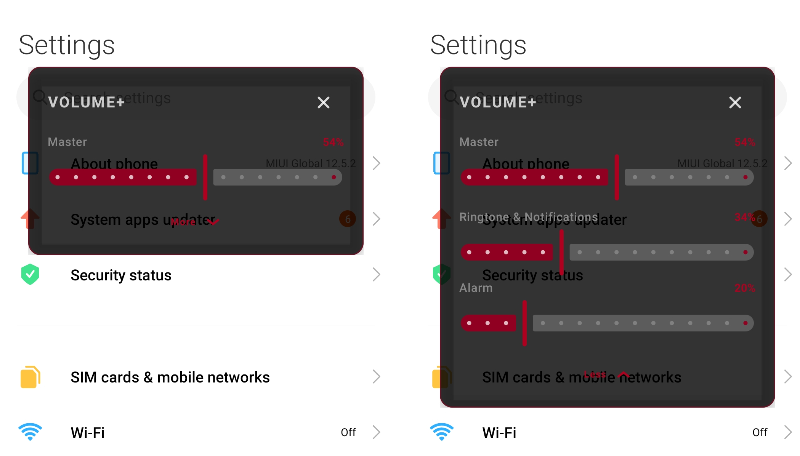
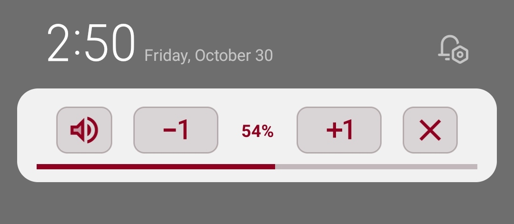
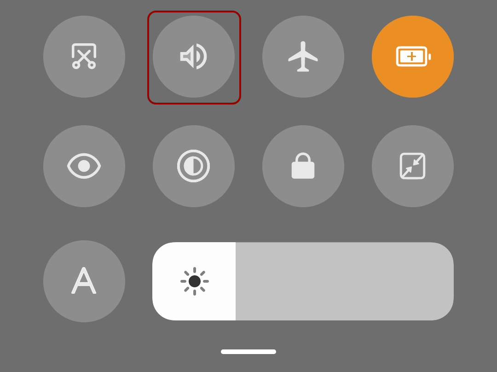

# Vol+

A lightweight Android volume-control utility with a floating control panel, a persistent notification, and a Quick Settings tile.

Vol+ provides quick access to the device's main audio streams without opening the full Settings app. The floating panel can be opened from the app launcher or the Quick Settings tile. Opening the panel starts the persistent notification controls.

## Features

- Floating volume panel with a compact main slider and expandable controls for additional audio streams.
- Dark interface with black surfaces and a deep-red accent.

- Persistent notification with volume percentage, progress indicator, mute, volume-up, volume-down, and close actions.

- Quick Settings tile for opening the floating volume panel.

- Synchronization with system volume changes while the notification service is running.
- Optional restoration of the notification service after device restart, subject to Android background-execution rules.

## Requirements

- API 24 or later.